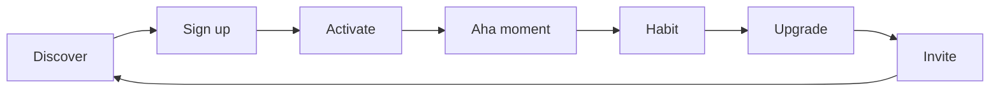

# Product-Led Growth Framework

> **Status:** Framework, not a template to fill in and forget. Read it once,
> then work the aha-moment worksheet at the end before you write any growth
> code.
>
> **Last updated:** Nov 8, 2026
>
> **Related docs:** [Billing Models](../architecture/BILLING_MODELS.md) (free
> tier and trial mechanics) | [Onboarding Workflow](../workflows/onboarding-new-customer.md)
> (the current onboarding flow this framework revises) |
> [Tracking Plan](../developer/tracking-plan.md) (every event named here) |
> [Analytics Setup](../developer/analytics-setup.md) |
> [Analytics Architecture](../architecture/ANALYTICS_ARCHITECTURE.md) |
> [Platform Overview](../prd/platform-overview.md) (growth model checkbox) |
> [Web to Mobile Launch Playbook](./WEB_TO_MOBILE_LAUNCH_PLAYBOOK.md)

## In one minute

Product-led growth means the product sells itself. A person finds it, signs
up without talking to anyone, reaches the value in minutes, and tells someone
else because the work they did in it is worth showing. That is the whole
idea. Everything in this doc serves one question: what is the first moment a
new user feels the product work, and how fast can we get them there?

If your product needs a sales call before anyone can try it, this framework
does not fit. Say so in the platform overview and pick a different model. Do
not bolt a free tier onto a sales-led product and call it PLG.

---

## 1. What PLG is and is not

**PLG is:**

- Self-serve signup. No demo request form standing between a visitor and the
  product.
- Value before payment. The free experience proves the paid one is worth it.
- Growth inside the product. Sharing, inviting, and upgrading happen where
  the user already works.
- Data-led decisions. You watch what users actually do, not what they say
  they will do.

**PLG is not:**

- A free tier with no path to paid. Free is a step, not the destination.
- A referral bribe program. Paying people to spam their contacts is
  marketing, not product-led growth, and it teaches users your product is
  not worth sharing on its own.
- A replacement for talking to users. Numbers tell you where people stop.
  Conversations tell you why.
- A fit for every product. High-touch enterprise software, regulated
  products that need onboarding by a human, and products whose value only
  appears after weeks of setup are usually sales-led or community-led
  instead. Pick honestly in `docs/prd/platform-overview.md`.

**The test:** can a stranger go from landing page to real value in one
sitting, with no help from you? If yes, PLG can work. If no, fix that first.
Growth mechanics on top of a product nobody can use alone are wasted effort.

---

## 2. The funnel, in order

Work the funnel top to bottom. A leak at the top makes everything below it
unreliable, and a fix at the bottom cannot save a funnel nobody enters.



| Stage | What it means | The question to ask |
|---|---|---|
| Discover | A person who needs this finds you | Where do they already look? |
| Sign up | They create an account | What friction did we remove? |
| Activate | They do the first meaningful action | Did they reach value? |
| Aha moment | They feel the value, in their own words | What action predicts staying? |
| Habit | They come back without a reminder | What brings them back? |
| Upgrade | They pay, because the free tier runs out at the right place | What did they hit that made paying obvious? |
| Invite | They bring someone else, because the work needs it | What did they share, and why? |

Each stage has one owner and one number. If two stages share a number, you
cannot tell which one broke. The numbers are in section 9.

**A note on order:** invite comes last on purpose. A user who has not reached
the aha moment has nothing worth inviting anyone to. Asking for an invite
before activation is the most common PLG mistake in this repo's onboarding
flow, which currently invites team members before the first key action. Move
the invite after the first success, not before it.

---

## 3. Finding the aha moment

The aha moment is the one action after which a user rarely leaves. It is not
a feature. It is a feeling, caused by an action, that you can measure.

### How to find it

1. List every action a user can take in the first week. Keep the list short:
   ten actions at most. If you have more, group them.
2. For each action, split your users into two groups: people who did it in
   their first week, and people who did not.
3. Compare week four retention between the two groups. The action with the
   biggest gap is your leading aha candidate.
4. Interview five people from the "did it and stayed" group. Ask what
   changed for them when they did it. If they cannot describe it in their
   own words, it is probably not the aha moment, even if the numbers look
   good. Correlation is a clue, not a verdict.
5. Write the aha moment as one sentence in the user's words, not yours. Pin
   it in the worksheet at the end of this doc. Every onboarding, pricing,
   and sharing decision should point back to that sentence.

### Worked example (fictional app)

The app is **Second Mat**, a fictional class planner for yoga teachers. It
is not a real product, and it is not CueCraft. A teacher signs up, builds a
class sequence, and shares it with students.

Candidate actions in week one: created an account, built a first sequence,
added music to a sequence, shared a sequence, taught a class from a sequence,
invited another teacher.

Retention check: teachers who **taught a class from a sequence they built in
Second Mat** stayed at four times the rate of teachers who only built one and
never taught from it. Teachers who only added music stayed at barely above
the baseline. The aha moment is not building. Building is work. The aha
moment is teaching from what you built, and feeling the class run smoothly.

In the teachers' own words: "I stopped looking at my notes halfway through
and just taught."

So Second Mat's onboarding does not end at "sequence saved." It ends at
"first class taught from a sequence," and the product reminds the teacher of
the class time, keeps the sequence one tap away during class, and asks after
class how it went. The free tier gives three taught classes, not three saved
sequences, because saved sequences are not the value. Taught classes are.

**Your turn:** run the same test on your own data before you copy any of the
example's conclusions. Your aha moment will be different. If you have no
users yet, pick your best guess, write it down as a guess, and set a date to
test it once you have 50 active users. A guessed aha moment with a test date
is useful. An untested aha moment treated as fact is not.

---

## 4. Free tier vs free trial

These are different tools. Most products need one of them, not both at once.

| | Free tier | Free trial |
|---|---|---|
| What it is | A limited version, free forever | The full paid version, free for a set time |
| Best when | The value is obvious in small doses, and the limit teaches the upgrade | The value only shows with the full feature set, or the product is habit-forming over weeks |
| Risk | So generous nobody upgrades | Ends before the user reaches the aha moment |
| Typical length | Forever, with a usage limit | 7 to 30 days (see `docs/architecture/BILLING_MODELS.md` for the trial config table) |

### Rules for a free tier that converts

1. **Give the aha moment away.** If the free tier does not include the aha
   moment, nobody discovers the value. Gate the volume around it, not the
   moment itself.
2. **Gate on usage, not on quality.** "3 projects free, unlimited paid" is a
   clean gate. "Free users get a worse version of the same feature" teaches
   users the product is mediocre.
3. **Make the limit visible before it is hit.** A user should see "2 of 3
   used" while working, not discover the wall mid-task. A surprise wall feels
   like a trap. A visible limit feels like a fair deal.
4. **One upgrade prompt at the limit, not five.** When the user hits the
   limit, show the upgrade once, clearly, with the price. Then let them
   decide. Nagging converts fewer people and annoys the rest.
5. **No credit card up front for a free tier.** Asking for a card before
   value is shown filters out everyone except the already convinced. For a
   trial, a card is a judgment call: it raises conversion of those who sign
   up and lowers signups. The billing models doc records the tradeoff. Pick
   one, write down why, and measure it.

### Rules for a free trial that converts

1. **The trial must be long enough to reach the aha moment twice.** Once is
   luck. Twice is a habit. If your aha moment takes a week of real use, a
   7-day trial is too short.
2. **Trial the plan people actually buy**, usually the most popular paid
   plan, not the cheapest and not the most expensive.
3. **Say what happens at the end, on day one.** Downgrade to free, or lose
   access? Say it in plain words at signup, and remind the user three days
   before the end. A surprise downgrade is a churn event you caused.
4. **Mid-trial, show unused value, not a countdown.** "You have not tried
   X yet, and it is the part paying users mention most" beats "3 days left"
   every time.

### What to gate, and what never to gate

- Gate: volume (projects, seats, exports, storage), advanced features
  (automation, integrations, team controls), support speed.
- Never gate: the aha moment, data export, account deletion, or the ability
  to leave. A product that holds data hostage does not retain users, it
  creates resentment and bad reviews.

---

## 5. Onboarding that gets to value in minutes

The onboarding workflow in `docs/workflows/onboarding-new-customer.md` is a
good skeleton. This section revises its weakest part: the feature tour.

**The rule:** onboarding is one job, not a tour. The user came to do one
thing. Help them do it, then get out of the way.

1. **Start with the job, not the profile.** Ask for the minimum needed to
   do the job. Name, avatar, timezone, and preferences can wait. Every field
   before the first value is a chance to leave.
2. **Use a template, not a blank page.** A blank editor is a test of
   imagination. A template is a head start. Give the user something real to
   edit, not an empty canvas and a tooltip.
3. **Empty states that teach.** An empty list should say what goes there,
   show one example, and offer one button to create it. An empty state that
   says "No items yet" teaches nothing.
4. **One success, celebrated plainly.** When the user completes the first key
   action, say so in one sentence and show what they made. No confetti
   animation is needed. The work itself is the reward.
5. **Skip the tour.** The current workflow has a tooltip tour of 3 to 5
   features as step 7. Replace it with contextual help: a short hint appears
   the first time a user reaches a feature, and only then. A tour explains
   everything and delivers nothing. A user who has just done the job does
   not need a tour of the building.
6. **Measure time to value, not tour completion.** The number that matters
   is minutes from signup to first key action. The onboarding workflow's
   target is under 10 minutes. If your number is above that, remove steps,
   do not add explanations.

**Email during onboarding:** one welcome email, one reminder at 24 hours if
the key action is undone, one at 72 hours offering help. The full trigger
table lives in the onboarding workflow doc. Do not add more emails. A user
who has not activated does not need a newsletter.

---

## 6. Honest viral loops

A viral loop is a reason to share that comes from the work itself. If the
only reason to share is a reward, the loop stops the day the reward stops,
and the people invited arrive expecting a reward, not a product.

**Loops that work:**

- **Share a real artifact.** The user made something in your product (a
  sequence, a report, a plan, a page) and sharing it is how the work gets
  used. The shared artifact carries the product with it. Second Mat teachers
  share a class sequence with students. The students see the product working.
- **Invite because the work needs a second person.** A teammate, a client, a
  student. The invite is functional, not promotional. The tracking plan
  already has `invite_sent` and `invite_accepted` for this.
- **A public profile.** A page the user is proud to link to, because it
  shows their work. This only works if the profile is genuinely good. A
  bare profile page nobody wants to share is not a loop.

**Loops that do not work:**

- Referral bribes for a product the user has not reached value in yet.
- "Share on social media" buttons with no artifact attached.
- Forced invites during onboarding, before the first success.
- Anything that sends email to people who did not ask for it.

**The test for any loop:** would the user share this if there were no reward
at all? If yes, add a small reward and measure it. If no, fix the artifact
first. And always make sharing a choice, never a gate. A user should never
have to invite someone to keep using the product.

---

## 7. Expansion revenue

PLG does not end at the first payment. The cheapest revenue is from a user
who already pays.

- **Seats.** A team starts with one person and grows. Price per seat, and
  make adding a seat a two-click action inside the product, not a sales
  conversation.
- **Usage.** The user does more of the thing they already value. Price the
  overage clearly, and warn before the limit, as in section 4.
- **Add-ons.** A second job the same user needs, sold inside the product.
  Only add an add-on after the core loop is healthy. An add-on on a broken
  core loop is a distraction.
- **Annual upgrade.** Offer annual billing at the point of satisfaction, not
  at signup. After the second month of happy use is a good time. At signup
  it is a commitment nobody has earned yet.

Record expansion as its own line in your metrics, not folded into new
revenue. If new signups hide falling expansion, you will miss the warning.

---

## 8. PQLs (product-qualified leads)

A product-qualified lead is a user whose behavior says they are ready to pay
or to expand, even if they have not said so. PLG companies talk to PQLs
instead of cold leads, because the conversation starts from real usage.

**What counts as a PQL depends on your product. Pick three signals, no more:**

1. A usage signal. For Second Mat: taught a third class from a sequence
   while on the free tier. The free limit is near, and the value is proven.
2. A team signal. Invited a second person who accepted and did the key
   action. The product is spreading inside a group.
3. A depth signal. Used a paid-only feature during a trial, or hit the same
   limit twice in a week.

**What to do with a PQL:** one personal message, from a human, referencing
the actual usage. "I saw you taught your third class this week. Want help
setting up the team plan?" That is the whole play. No drip sequence, no
generic upgrade email. If the user does not reply, do not chase. The product
is still there, and the next limit will prompt them again.

**What not to do:** do not score every click. A PQL model with twenty
signals is a model nobody trusts. Three signals, reviewed monthly, beats a
complex model that nobody maintains. And do not hand PQLs to a sales process
that treats them like cold leads. The point is that they are warm.

---

## 9. Metrics: the table

Every metric below maps to events already in
`docs/developer/tracking-plan.md`. If an event is missing for your product,
add it to the tracking plan **before** you write code for the feature. The
tracking plan is the source of truth, not this doc.

| Metric | Definition | How to measure it here |
|---|---|---|
| Signup rate | Signups divided by landing page visitors | `page_view` to `signup_completed`, 14-day window |
| Activation rate | Signups who complete the first key action | `signup_completed` to `core_action_completed`, 7-day window |
| Time to value | Median minutes from signup to first key action | `signup_completed` timestamp to `core_action_completed` timestamp |
| Aha rate | Signups who do the aha action in week one | Funnel on your aha event, 7-day window |
| Weekly active users | Users with a qualifying action in the last 7 days | `core_action_completed` or `core_entity_created`, per the tracking plan retention definition |
| Upgrade rate | Free or trial users who pay | `signup_completed` to `payment_completed`, 30-day window |
| Trial-to-paid rate | Trial users who convert | Trial cohort to `payment_completed`, per `docs/architecture/BILLING_MODELS.md` |
| Invite rate | Active users who send an invite | `invite_sent` divided by weekly active users |
| Invite acceptance | Invites that turn into active users | `invite_sent` to `invite_accepted` |
| Expansion revenue | Revenue from existing customers beyond their first plan | `subscription_upgraded` and seat or usage growth, reported separately from new revenue |
| Churn | Paying users who cancel and do not return | `subscription_cancelled` with no `subscription_reactivated` in 30 days |

**How to read the table:** look at one stage at a time, week over week. A
single week's number is noise. Four weeks of direction is a signal. Do not
report a metric you cannot trace to an event. If the event is not firing,
the metric is a guess, and guesses do not go in reports.

**Targets are yours to set.** The onboarding workflow suggests over 70
percent onboarding completion, under 10 minutes to first value, over 50
percent day-1 retention, over 30 percent day-7 retention, and over 5 percent
trial-to-paid conversion. Treat those as starting points to test against
your own product, not as promises. A consumer app and a team tool will not
share targets, and pretending they do hides the real number.

---

## 10. Common PLG mistakes

1. **A free tier so generous nobody upgrades.** If the free tier covers the
   whole job, the upgrade is a donation. Gate the volume, not the value.
2. **Onboarding that explains everything and delivers nothing.** A tour, a
   checklist of ten setup steps, and a welcome video, before the user has
   done the job once.
3. **A viral loop nobody wants to share.** A bare "invite friends" button
   with no artifact. See section 6.
4. **Measuring signups instead of activation.** Signups are cheap. Activated
   users are the business. A signup spike with flat activation is a leak,
   not growth.
5. **Chasing PQLs with a sales script.** The user did the work in the
   product. Meet them there, with one specific message, or do not message
   them at all.
6. **Changing the free tier after users built on it.** Taking away what free
   users already rely on is the fastest way to lose trust. If the free tier
   must change, grandfather existing users and say so plainly.
7. **Copying another company's funnel.** Their aha moment is not yours.
   Their limits are not yours. Use the method in section 3, not their
   numbers.

---

## 11. A 30/60/90-day starter plan

### Days 1 to 30: find the value

- Write your guessed aha moment in the worksheet below. Set the test date.
- Instrument the funnel events from section 9. Verify each one fires in
  PostHog or GA4 before you trust any number.
- Ship the one-job onboarding from section 5. Remove the tour.
- Pick the free tier or trial, and write down why, with the gate and the
  limit.

### Days 31 to 60: prove the loop

- Run the aha test from section 3 on real users. Rewrite the aha sentence
  in their words.
- Fix the biggest funnel leak, not the smallest. One fix, measured for two
  weeks.
- Ship one honest sharing artifact. Measure invite rate before and after.
- Define your three PQL signals and send the first five personal messages.

### Days 61 to 90: grow what works

- Set targets from your own data, not from this doc's starting points.
- Add one expansion path (seats, usage, or an add-on). Measure expansion
  revenue separately.
- Review the free tier: is it converting, or is it too generous? Change the
  volume, never the aha moment, and grandfather existing users.
- Write down what you will not do next quarter. A PLG plan with no "not
  doing" list grows into a pile of mechanics nobody maintains.

---

## 12. For experts

- **Cohort retention by action** is the core analysis. Build it as a
  retained-users table: rows are signup weeks, columns are weeks since
  signup, cells are the share still active. Then split the same table by
  whether the user did the candidate aha action in week one. The gap is the
  finding. A single aggregate retention number hides it.
- **Survivorship bias** is the trap. Users who stay do more of everything,
  so every action correlates with staying. The interview step in section 3
  is what separates a real aha moment from "active users are active." So is
  a time check: the aha action should come **before** the retention gap
  opens, not after.
- **Pricing psychology:** a free tier limit that is hit in the second week
  of real use converts better than one hit on day one (too soon, feels like
  a trial) or never hit (too generous). If nobody hits the limit, the limit
  is decorative.
- **PQL scoring:** keep it to three signals with a simple rule, such as "any
  two of three signals in 14 days." Revisit the signals monthly. Retire a
  signal that never fires or that fires for everyone.
- **Attribution:** PLG does not remove the need for attribution. UTM
  parameters and the attribution tracking doc still decide which discovery
  channel brings activated users, not just signups. See
  `docs/prd/ATTRIBUTION_TRACKING.md`.

---

## 13. For agents

Read this section before writing any growth code or copy in this repo.

- **Add events to the tracking plan first.** If the event is not in
  `docs/developer/tracking-plan.md`, add it there with its name, trigger,
  properties, and priority, then implement it. Never invent an event name in
  code.
- **Never invent metrics.** Report only numbers that come from a firing
  event. If an event is not firing, write UNVERIFIED, not a number.
- **Never change pricing, free tier limits, or trial length in code
  without a human decision.** Draft the change, with the reason and the
  expected effect, and hand it to the owner. Pricing is a human-only gate.
- **Never write a viral loop that emails people who did not ask to be
  contacted.** Sharing is a user action. The agent builds the artifact and
  the share control, not the outreach.
- **Never present a guessed aha moment as a finding.** Label it "guess, test
  date [DATE]" until the cohort test in section 3 has run.
- **When you revise onboarding, remove steps before you add them.** A
  revision that adds a tour, a checklist, or a video has failed this
  framework. The onboarding workflow doc is the file to update, and the
  change goes through the owner.
- **Do not duplicate the billing models doc.** Free tier mechanics, trial
  configuration, proration, and dunning live in
  `docs/architecture/BILLING_MODELS.md`. Link to it. Do not copy its tables
  here.
- **Do not duplicate the SEO work.** Discovery is a channel, and the
  search-indexing skill (`skills/search-indexing-skill/SKILL.md`) and
  `docs/guides/SEO_SETUP_GUIDE.md` own it. This framework owns what happens
  after a visitor arrives.

---

## Aha-moment worksheet (fill in)

```markdown
Our product: [YOUR_APP_NAME]
Our user's job: [One sentence, in the user's words]
Guessed aha moment: [One action, in the user's words]
Why we think so: [One or two sentences]
Test date: [DATE, once we have 50 active users]
Cohort result: [Retention gap, or UNVERIFIED]
Revised aha moment (in users' words): [After interviews]
Free tier limit that protects it: [Usage limit, not the moment itself]
First sharing artifact: [What the user shares, and why]
Three PQL signals: [1. / 2. / 3.]
```

---

## Checklist

- [ ] Aha moment written in the user's words, with a test date
- [ ] Funnel events from section 9 firing and verified in analytics
- [ ] Free tier or trial chosen, with the gate and the limit written down
- [ ] Onboarding is one job, no tour, time to value measured
- [ ] One honest sharing artifact shipped, invite rate measured
- [ ] Three PQL signals defined, first personal messages sent
- [ ] Expansion revenue reported separately from new revenue
- [ ] Growth model recorded in `docs/prd/platform-overview.md`
- [ ] Billing mechanics linked, not duplicated, from `docs/architecture/BILLING_MODELS.md`
